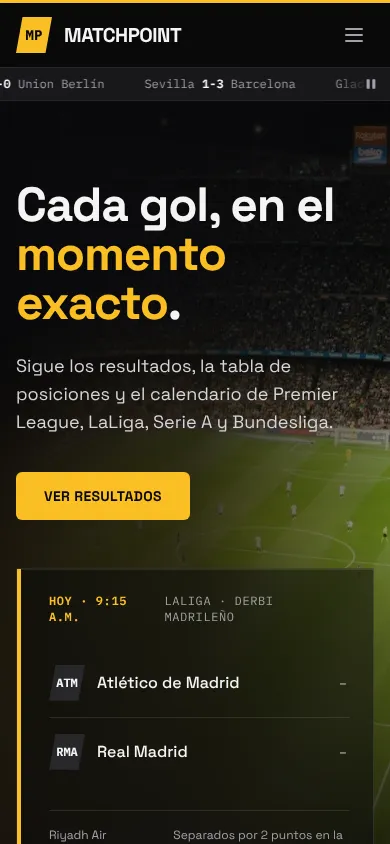

# MatchPoint

Portal de fútbol europeo con los resultados, el calendario, los equipos y la tabla de posiciones de la Premier League, LaLiga, la Serie A y la Bundesliga. Empezó como laboratorio de Tailwind CSS en la materia Construcción de Software (Ingeniería de Sistemas, Universidad Santo Tomás, Tunja) y se terminó como proyecto de portafolio.

<p>
  
  
</p>

## Funcionalidades

- **Cinco páginas**: inicio, resultados del fin de semana, calendario, equipos y tabla de posiciones.
- **Equipo favorito**: marcas un equipo con la estrella y queda resaltado en todo el sitio (resultados, calendario, posiciones y el carrusel de marcadores). Se guarda en el navegador con `localStorage`.
- **Filtros de partidos** en Resultados y Calendario: por liga, búsqueda por nombre o sigla del equipo (sin importar tildes ni mayúsculas) y "Solo mi equipo". Si un filtro no encuentra partidos, se muestra un estado vacío con un botón para quitar los filtros.
- **Tabla de posiciones** con pestañas por liga (también con las flechas del teclado) y orden por columna. La pestaña queda en la dirección (`posiciones.html#laliga`), así que se puede compartir.
- **Menú móvil** accesible: se abre con el botón del encabezado y se cierra con Escape, tocando fuera o eligiendo una página.
- **Carrusel de marcadores** con botón de pausa. Se queda quieto si el sistema pide reducir el movimiento.
- **Accesibilidad**: enlace "Saltar al contenido", foco visible, página actual marcada en la navegación, objetivos táctiles de 44 px y anuncios para lectores de pantalla en los filtros.
- **Funciona sin JavaScript**: las cuatro tablas y todos los partidos se ven completos; el JavaScript solo agrega los filtros, las pestañas y el favorito.

## Tecnologías

- HTML5.
- [Tailwind CSS v3](https://tailwindcss.com/) compilado a un archivo estático (`css/tailwind.css`), más estilos propios en `css/estilos.css`.
- JavaScript sin frameworks (`js/main.js`, `js/filtros.js`, `js/posiciones.js`).
- Google Fonts: Space Grotesk (textos) e IBM Plex Mono (marcadores y datos).
- Imágenes en formato WebP, con versiones más livianas para celular.

## Cómo abrirlo

No necesita servidor: abre `index.html` con doble clic o con la extensión **Live Server** de Visual Studio Code. Las fuentes se cargan desde Google Fonts, así que con internet se ven como en las capturas.

### Volver a generar el CSS de Tailwind

Solo hace falta si cambias clases de Tailwind en los HTML o en `js/`. Requiere Node.js.

```bash
npm install
npm run build:css     # genera css/tailwind.css minificado
npm run watch:css     # lo regenera mientras editas
```

La configuración (colores, fuentes) está en `tailwind.config.js` y la entrada en `src/input.css`. `css/tailwind.css` no se edita a mano.

## Estructura de carpetas

```
matchpoint/
├── index.html            Inicio: partido destacado y accesos al sitio
├── resultados.html       Resultados del fin de semana con filtros
├── calendario.html       Próximos partidos con filtros
├── equipos.html          Equipos destacados y botón de favorito
├── posiciones.html       Tablas por liga con pestañas y orden por columna
├── favicon.svg
├── css/
│   ├── tailwind.css      Generado por Tailwind (no editar)
│   └── estilos.css       Estilos propios: ticker, menú móvil, favorito, tablas
├── js/
│   ├── main.js           Menú móvil, pausa del ticker y equipo favorito
│   ├── filtros.js        Filtros de Resultados y Calendario
│   └── posiciones.js     Pestañas y orden de la tabla de posiciones
├── src/input.css         Entrada de Tailwind
├── tailwind.config.js    Configuración de Tailwind
├── package.json          Comandos para compilar el CSS
├── imagenes/             Fotos en WebP
├── docs/                 Capturas usadas en este README
├── netlify.toml          Cabeceras de seguridad y caché para Netlify
├── README.md
└── CAMBIOS.md            Qué se cambió al terminar el proyecto y por qué
```

## Seguridad

Es un sitio estático: no tiene servidor, base de datos, claves de API ni funciones en la nube, así que no hay nada que un bot pueda usar para gastar recursos o leer datos.

- `netlify.toml` agrega cabeceras de seguridad en Netlify: una política de contenido (`Content-Security-Policy`) que solo permite los recursos que el sitio usa, bloqueo para que otras páginas no lo metan en un `iframe`, `nosniff`, HTTPS obligatorio y caché para las imágenes.
- Solo carga archivos propios y Google Fonts. Los recortes diagonales que estaban como `style=""` en el HTML pasaron a clases de CSS, así que la política no necesita permitir estilos en línea.

## Créditos

- Las imágenes son de terceros y se usan con fines educativos. Los nombres y escudos de clubes y ligas pertenecen a sus dueños.
- Los resultados y tablas son datos de ejemplo escritos a mano; no se actualizan solos.
- Tailwind CSS, Space Grotesk e IBM Plex Mono son proyectos de código abierto de sus respectivos autores.
